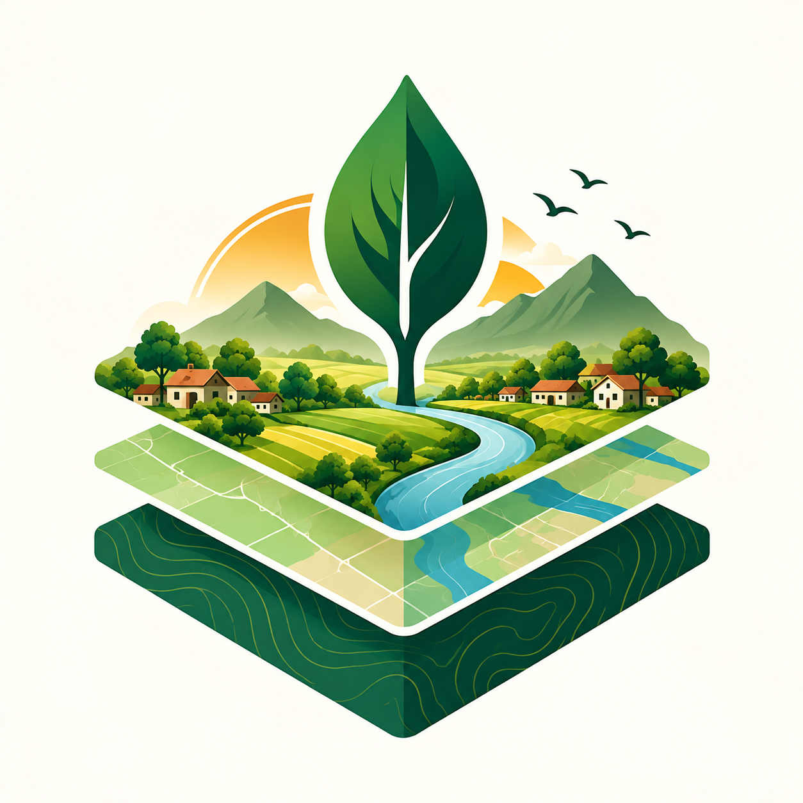
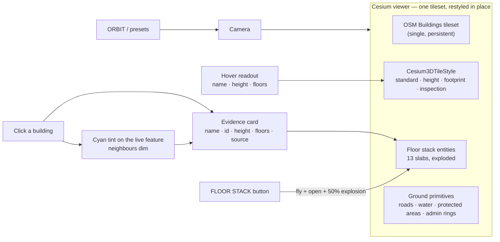
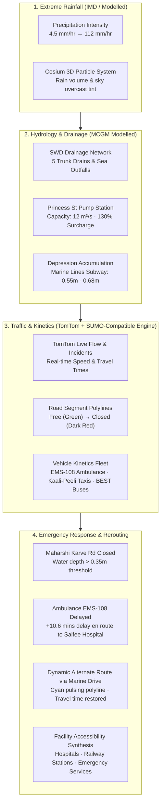
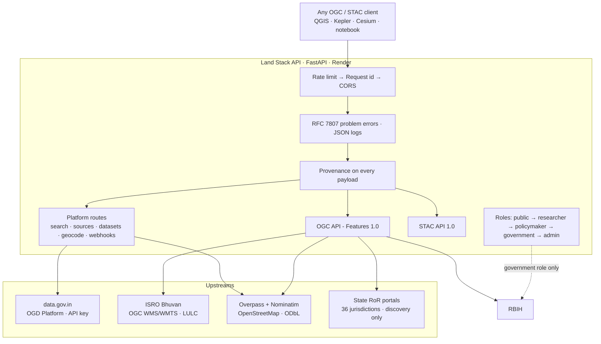
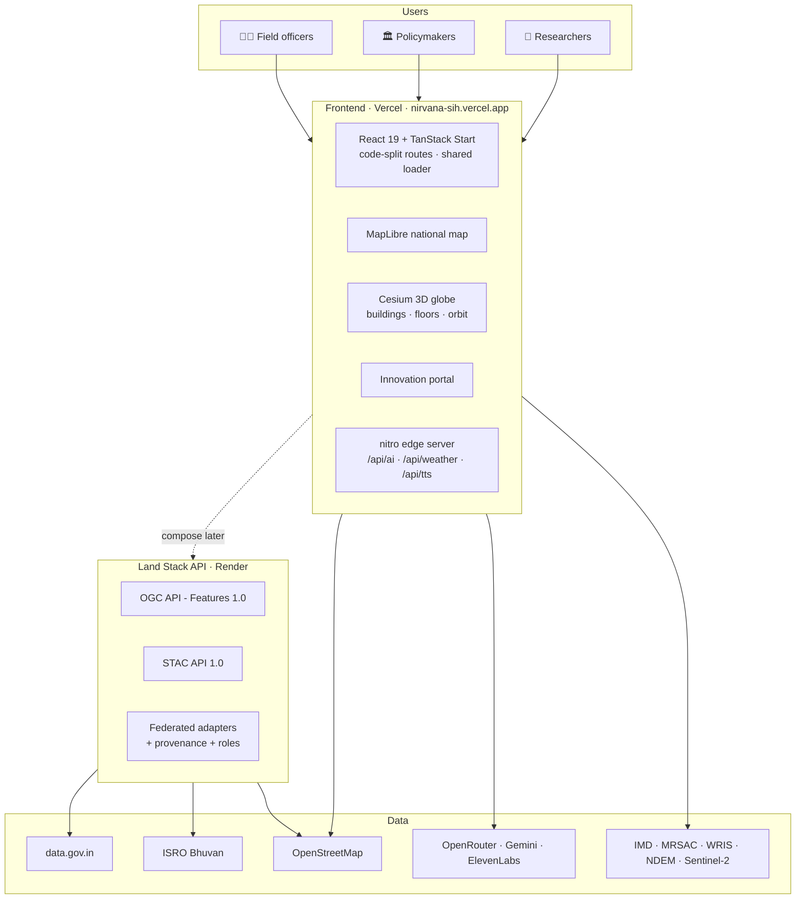
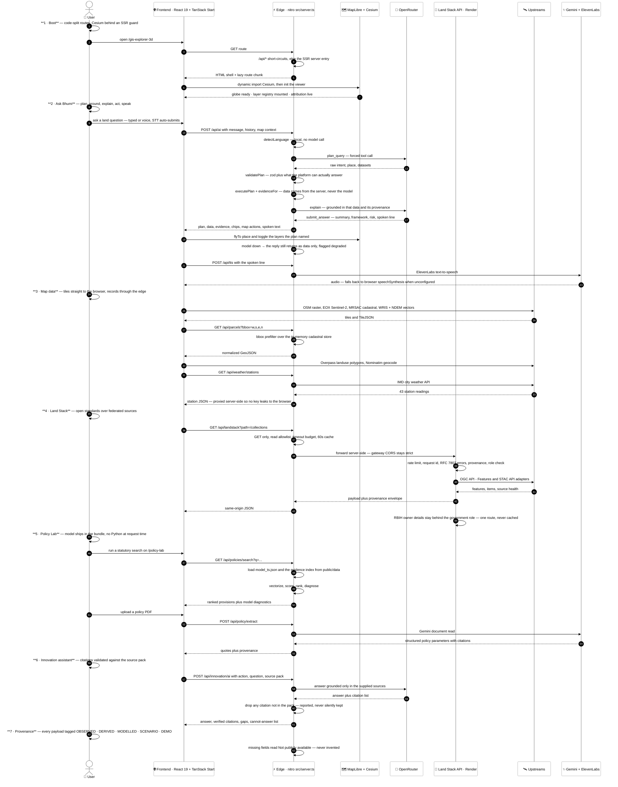
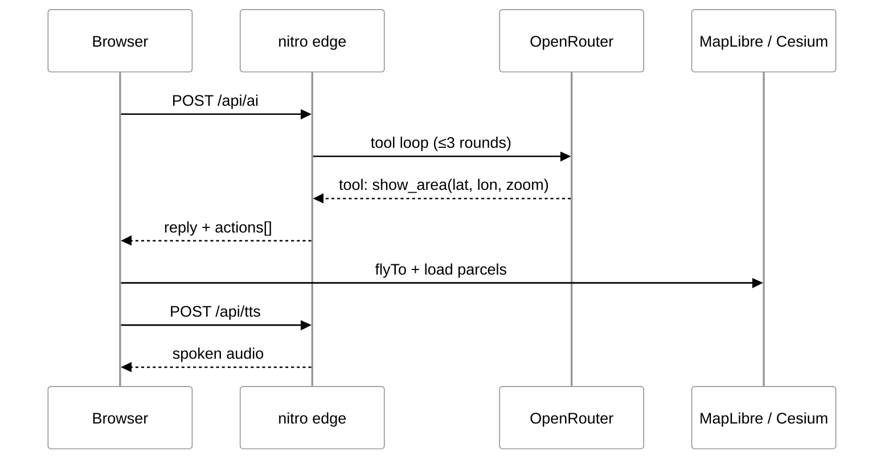

<div align="center">



# निर्वाण · NIRVANA

**National Platform for Research & Policy Innovation in Land Governance**

_Land · Data · Policy · India — a map-first workspace for cadastral parcels, disputes,
climate risk, applied research and a **voice-first AI land analyst**._

<br />


<br />

[](https://nirvana-sih.vercel.app)
[](https://bhumi-niti-landstack.onrender.com/health?probe=false)


<br />

**[Mission](#mission)** · **[Coverage](#requirement-coverage)** · **[Features](#features)** ·
**[3D GIS](#3d-gis-explorer--gis-explorer-3d)** · **[Land Potential & Time Machine](#land-potential--time-machine)** · **[Land Stack API](#-land-stack-api)** ·
**[Architecture](#architecture)** · **[Data](#data-honesty)** · **[Quick Start](#quick-start)** ·
**[API](#api-reference)** · **[Deploy](#deployment)** · **[Roadmap](#roadmap)**

</div>

---

## 🎬 Interactive Architecture

Open the source-backed runtime map — click any node to inspect it, trace paths,
compare the public edge against the federation zone, and export a share card.

**[▶ Open the interactive architecture diagram](docs/architecture/nirvana-architecture.html)**

<p align="center">
  
  <br />
  <sub><b>Two services, one platform.</b> Green pulses are the Vercel experience layer, gold pulses the Render integration gateway, blue the open standards and AI services.</sub>
</p>

**Viewer controls** — `/` focus a node · `PATH` trace a route · `LENS` compare two
roles · `M` overview radar · `F` presentation stage · `T` toggle theme · `E` export.

> **How it is built.** [`tt-a1i/archify`](https://github.com/tt-a1i/archify) —
> typed JSON IR, schema validation, layout-clearance checks and route-label
> collision detection, delivered as one self-contained HTML file. The editable
> source is [`docs/architecture/nirvana.architecture.json`](docs/architecture/nirvana.architecture.json);
> regenerate with `node archify/bin/archify.mjs deliver architecture
docs/architecture/nirvana.architecture.json docs/architecture/nirvana-architecture.html
--quality showcase`.

---

<a id="mission"></a>

## 🎯 Mission

Land is a **finite, strategic resource** underpinning economic development,
environmental sustainability, food security, urban expansion and social equity.
Yet India's land-administration ecosystem is largely _implementation-oriented_ —
little institutional focus on **applied research, policy experimentation and
evidence-based innovation**.

Nirvana is a **national knowledge ecosystem** where researchers, policymakers,
academies and government agencies meet to collect evidence, run policy experiments
and publish findings — not an official record system.

### The gap we close

| Problem today                                            | What Nirvana does                                             |
| -------------------------------------------------------- | ------------------------------------------------------------- |
| Data exists in silos, barely used                        | A federated API that speaks open standards                    |
| Research and policy live in separate portals             | One repository + collaborative workspaces                     |
| No way to _test_ a policy before announcing it           | Policy Lab simulation + scenario modelling                    |
| Map tools show data without saying how trustworthy it is | Every payload carries source, licence, evidence grade         |
| Building footprints are flat, meaningless boxes          | 3D buildings with storeys and floor separation                |
| Land records are state silos with no public API          | A 36-jurisdiction discovery index + the sanctioned RBIH route |

---

<a id="requirement-coverage"></a>

## ✅ Requirement Coverage

Every point of the problem statement, and where it lives:

| #   | Requirement                                                      | Status | Where                                                                                         |
| --- | ---------------------------------------------------------------- | ------ | --------------------------------------------------------------------------------------------- |
| 1   | National repository for research, policy, datasets, legal docs   | ✅     | Innovation Portal + Innovation Home, 16 policy instruments + 10 dataset records + file upload |
| 2   | AI-powered search & recommendation                               | ✅     | Ask Bhumi agent (`src/server/ai-agent.ts`, 840-line OpenRouter tool loop)                     |
| 3   | Collaborative workspaces for researchers & agencies              | ✅     | `/innovation/workspace/$projectId`                                                            |
| 4   | Interactive GIS: land use, climate, infrastructure, policy       | ✅     | MapLibre national map + Cesium 3D globe                                                       |
| 5   | Advanced analytics & decision support                            | ✅     | Policy Lab, Land-Difference, climate timeline, 26 indicator series                            |
| 6   | Policy simulation before implementation                          | ✅     | `/policy-lab` (evaluate existing / simulate new)                                              |
| 7   | Centralised digital repository                                   | ✅     | Research Hub, Innovation Hub, upload + policy extract                                         |
| 8   | AI search & recommendation engine                                | ✅     | Ask Bhumi + copilot, validated query plans                                                    |
| 9   | Collaborative workspaces                                         | ✅     | Workspace + Copilot screens                                                                   |
| 10  | Interactive GIS visualisation                                    | ✅     | GIS Explorer 2D + 3D (38 layers, 6 groups)                                                    |
| 11  | Advanced analytics & decision support                            | ✅     | Evidence panels, provenance engine (742 graded citations)                                     |
| 12  | Policy simulation modules                                        | ✅     | Policy Lab                                                                                    |
| 13  | Integration: satellite, land records, socio-economic, geospatial | ✅     | **Land Stack API** federates ISRO, OSM, data.gov.in, RBIH                                     |
| 14  | AI research tools: trend, synthesis, predictive, scenario        | ✅     | Copilot + simulation engine, Difference-in-Differences panel                                  |
| 15  | Innovation portal: hackathons, grants, pilots, competitions      | ✅     | Challenges → pilots → impact → submit                                                         |
| 16  | Dashboards: research, policy KPIs, land use, climate, disputes   | ✅     | Dashboard + 3D scenario drawer + Research Hub                                                 |
| 17  | Secure role-based access                                         | ✅     | 5-role model (see [Security](#security--privacy))                                             |
| 18  | **APIs for integration with government/GIS systems**             | ✅     | **Land Stack API** — OGC + STAC, see below                                                    |

✅ = shipped and reachable in this repo. The platform is a serious prototype;
nothing here substitutes for statutory records, and no requirement is marked
complete on the strength of a mock — a working implementation sits at every ✅.

### Where the honest gaps still are

Ticking the table above describes **features**, not **data coverage**. These
remain deliberately unfinished, and the UI says so at the point of use:

| Gap                | Current state                                                                                                 |
| ------------------ | ------------------------------------------------------------------------------------------------------------- |
| Live land records  | Records of Rights are a **discovery index** (36 State/UT portals) — no parcel-level RoR is fetched, by design |
| RBIH owner details | Implemented and role-gated, but **unconfigured** until institutional credentials exist                        |
| data.gov.in        | Adapter is live but **unconfigured** until a valid API key is added                                           |
| Bhuvan rasters     | WMS/WMTS reachable but **slow** from the gateway host — documented layers still render                        |
| Search ranking     | Ask Bhumi retrieves over an LLM tool loop; there is no trained ranking model                                  |
| Predictive models  | Difference-in-Differences and scenario models are **modelled**, not validated forecasts                       |

---

### Measured proof panel

Every number below is regenerated by the scripts in `eval/` (see `eval/RESULTS.md`
for the full narrative). Numbers not in this table are NOT MEASURED — the repo
deliberately says so rather than estimates.

| Metric                                                                  | Measured value                                 | Source                          |
| ----------------------------------------------------------------------- | ---------------------------------------------- | ------------------------------- |
| Statutory applicability model — AUC                                     | 0.970 ± 0.012 (5-fold GroupKFold by enactment) | `public/data/model_report.json` |
| … — F1                                                                  | 0.853 ± 0.021                                  | same                            |
| … — training rows / enactments / jurisdictions                          | 71,755 / 5,654 / 37                            | same                            |
| … — vs constant-predictor baseline                                      | 0.970 vs 0.500                                 | same                            |
| Cited copilot — citation precision, document level                      | 0.890                                          | `eval/RESULTS.md`               |
| … — clause level                                                        | 0.325 (163 citations)                          | same                            |
| … — gold instrument retrieved                                           | 49/50                                          | same                            |
| … — exact supporting clause retrieved                                   | 43/50                                          | same                            |
| Safe NL-GIS — adversarial plans neutralised at the validation layer     | 20/20                                          | same                            |
| Safe NL-GIS — AI-written SQL reaching a database                        | 0 (no DB client in repo)                       | same                            |
| Policy engine checks (`verify:sim`)                                     | 288 passing, exit 0                            | eval harness                    |
| Typecheck / build                                                       | exit 0                                         | eval harness                    |
| Unit tests in this repo                                                 | 0 (none defined)                               | eng eval                        |
| Backend repo (`landstack-api`) pytest                                   | 67 passed · 0 failed                           | separate repo                   |
| `docker compose up`                                                     | not runnable — no compose file                 | eng eval                        |
| Conversion (xgboost) model AUC/F1, Title Integrity recall, RAGAS scores | NOT MEASURED — code/data not in repo           | eval/RESULTS.md                 |

Reproduce:

```sh
python eval/model_eval.py && python eval/rag_eval.py && python eval/rules_eval.py \
  && python eval/nlgis_eval.py && python eval/eng_eval.py && python eval/run_all.py
npx tsx eval/_retrieve.ts && npx tsx eval/_fuzz_plan.ts
npm run verify:sim && npm run verify:geometry && npm run typecheck && npm run build
```

---

<a id="features"></a>

## ✨ Features

<table>
<tr>
<td width="50%">

### 🗣️ Ask Bhumi — voice-first AI

Speak or type; the query **auto-submits on silence**. An OpenRouter tool-loop agent
answers with a structured risk / framework / evidence card, **narrates the reply**
via the Web Speech API, and **flies the map** to the place you asked about.

</td>
<td width="50%">

### 🌐 3D globe with real OSM buildings

CesiumJS renders the OSM Buildings tileset and **restyles it in place** across four
modes (standard / height / footprint / inspection). One tileset, never rebuilt —
layer toggles only flip `tileset.show`.

</td>
</tr>
<tr>
<td width="50%">

### 🎥 Camera presets + 360° orbit

NORTH, TOP, 45°, ISO, ±45° steps and a true turntable orbit, with a live
heading/pitch readout. Works at national scale and at plot scale.

</td>
<td width="50%">

### 🏢 Storeys on every building

A single `buildingFloors` service derives a floor count for **every** building: the
real `building:levels` tag when OSM carries it, otherwise derived from measured
height at a documented 3.2 m storey, otherwise a clearly labelled modelled stand-in.

</td>
</tr>
<tr>
<td width="50%">

### 🧱 Floor separation stack

The **FLOOR STACK** shortcut flies to the Patna fixture and opens a 13-slab
exploded view with an explosion slider and per-floor pills — and says plainly it is
a **demo model, not a survey**.

</td>
<td width="50%">

### 🗺️ Real cadastral + WRIS/NDEM layers

State-aware **MRSAC cadastral vector tiles**, plus WRIS rivers/waterbodies and
NDEM flood-extent overlays — each with licence, coverage and "not a forecast" chips.

</td>
</tr>
<tr>
<td width="50%">

### 🌦️ IMD live weather + climate timeline

43 live IMD stations with a Temperature / Rainfall toggle, and year-scrubbing
(2018 → 2024) over Sentinel-2 cloudless mosaics.

</td>
<td width="50%">

### 🏷️ Evidence provenance everywhere

Every dataset, KPI, building and AI claim carries an **evidence class** (observed /
derived / modelled / synthetic) and a reliability badge — with an explicit
"Not publicly available" state instead of invented values.

</td>
</tr>
</table>

---

<a id="3d-gis-explorer--gis-explorer-3d"></a>

## 🌐 3D GIS Explorer — `/gis-explorer-3d`



| Constraint                   | How it is respected                                                   |
| ---------------------------- | --------------------------------------------------------------------- |
| One tileset, never rebuilt   | Layer toggle only flips `tileset.show`; styles mutate `tileset.style` |
| No fabricated geometry       | Floor counts labelled by basis; the stack is a declared demo fixture  |
| No silent partial answers    | A truncated upstream extract carries a `provenance` warning           |
| Cesium out of the SSR bundle | Globe dynamically imported behind an SSR guard                        |

> **What the tileset does _not_ have:** Ion's OSM Buildings ships no per-feature
> properties, so per-building colour banding is impossible. The globe therefore uses
> a deliberate colour per mode and puts per-building detail in the hover readout and
> evidence card, where it is real.

---

<a id="pravaah-digital-twin"></a>

## 🌊 PRAVAAH — 3D Urban Flood & Traffic Digital Twin (Marine Lines, Mumbai)

**PRAVAAH** extends Nirvana's 3D GIS Explorer into a city-scale, flood-aware urban digital twin centered on **Marine Lines, South Mumbai** (`18.9430° N, 72.8230° E`). Built for the **Smart India Hackathon (SIH)**, it models and visualizes how extreme monsoon precipitation, drainage surcharge, localized street waterlogging, vehicular gridlock, and emergency response interact in a cascading disaster scenario.



### 🎯 9-Stage Heavy Rainfall Cascade Scenario

The digital twin includes an automated interactive scenario engine with step controls and automated transition:

| Stage       | Name                                  | Rainfall    | Network Impact                                                             | Emergency Response                                      |
| :---------- | :------------------------------------ | :---------- | :------------------------------------------------------------------------- | :------------------------------------------------------ |
| **Stage 1** | **Initial City State**                | 4.5 mm/hr   | Normal baseline operations across Marine Lines. Speed 42 km/h.             | EMS-108 dispatched; ETA 4.2 mins                        |
| **Stage 2** | **Rainfall Intensifies**              | 48.0 mm/hr  | Rain starts falling heavily; wet pavement speeds drop to 32 km/h.          | Surface drainage at 78% capacity                        |
| **Stage 3** | **Drainage Capacity Exceeded**        | 82.0 mm/hr  | Princess St pump station utilization hits 130% (surcharge).                | Localized runoff begins ponding                         |
| **Stage 4** | **Low-Lying Water Accumulation**      | 104.0 mm/hr | Low-lying railway depression submerges to 0.55m depth.                     | Traffic stalls around Maharshi Karve Rd                 |
| **Stage 5** | **Traffic Gridlock & Congestion**     | 112.0 mm/hr | Network speed plummets to 15 km/h. Red congestion across arterial streets. | Widespread congestion alerts                            |
| **Stage 6** | **Ambulance Delayed**                 | 108.0 mm/hr | Water depth exceeds 0.35m wading limit. EMS-108 gridlocked.                | EMS-108 delay jumps to **+10.6 mins**                   |
| **Stage 7** | **Road Closure & Alternate Routing**  | 95.0 mm/hr  | Maharshi Karve Rd automatically marked **CLOSED** (>0.35m).                | **Dynamic alternate route calculated via Marine Drive** |
| **Stage 8** | **Infrastructure Accessibility Risk** | 68.0 mm/hr  | Saifee Hospital corridor accessibility restored via coastal bypass.        | Coastal speeds recover to 38 km/h                       |
| **Stage 9** | **End-to-End Cascade Causality**      | 22.0 mm/hr  | Full incident synthesis & chronological causality timeline generated.      | Digital twin reports final disaster metrics             |

### 🛰️ Data Sources & Provenance Honesty

Every data element inside PRAVAAH is classified and displayed with technical transparency:

- **Observed (`observed` / `tomtom-live`):**
  - Live TomTom Traffic Flow Segment API (`/api/traffic/flow`)
  - Live TomTom Traffic Incidents API (`/api/traffic/incidents`)
  - OpenStreetMap 3D building geometries and real road network centerlines.
- **Forecast (`forecast` / `open-meteo`):**
  - Open-Meteo's 72-hour weather forecast is available for one representative
    coordinate in each of India's 28 states and 8 union territories at
    `/api/pravaah/india/weather`. This is forecast-model output, not live
    observation or state-wide spatial coverage; it is not used to label the
    separate synthetic state-risk scenarios as real.
- **Experimental model (`modelled_synthetic`):**
  - `GET /api/pravaah/india/predictions` applies a River SGD regressor and
    logistic classifier to weather forecasts and explicit synthetic proxies
    spanning river/soil, traffic/transit, power, hospital/EMS, satellite/
    geospatial, incident, and citizen-report features. Only rainfall inputs
    come from the live Open-Meteo forecast; the remaining dynamic domains are
    synthetic or static registry proxies and are identified in each response.
    The model artifact is regenerated with `npm run train:synthetic-flood-model`.
    Holdout scores in `data/evaluation/synthetic-cascade-model-v2.json`
    measure agreement with the synthetic teaching rule only;
    they are not empirical flood accuracy or calibrated probabilities.
    Research-only; do not use for warnings or emergency dispatch.
- **Cascade replay (`simulated_stream`):**
  - `GET /api/pravaah/cascade?rollouts=500` runs a 48-hour synthetic multi-
    system event replay, event-time quality filtering, lagged correlation
    discovery, weak physical-prior graph edges, per-zone/city 1–72 hour risk
    distributions, and reproducible Monte Carlo time-to-critical samples.
    Graph edge evidence distinguishes inferred synthetic associations from
    weak priors. These are demonstration computations, not calibrated
    real-world cascade probabilities. The `/cascade` workspace surfaces all
    nine requirement statuses, forecast horizons, provenance and quality flags,
    dependency evidence, zone explanations, state/UT coverage, and validation
    limits alongside the existing graph explorer.
- **Intervention optimizer (synthetic decision-support demo):**
  - `POST /api/pravaah/interventions` accepts a bounded resource budget and
    candidate actions, then greedily selects actions with modeled benefit.
    It accounts for declared resource use, start delay, optional zone targeting,
    and catalogued side effects. It returns baseline/intervened forecasts,
    resource use, and zone-level risk deltas. The optimizer uses stable
    log-survival improvement for ranking, avoiding saturation when an
    all-India probability-of-any-zone-critical value approaches one.
    Results remain synthetic and must not be treated as operational advice.
  - The current R1–R9 implementation and evidence gaps are tracked in
    [`docs/PRAVAAH_REQUIREMENTS_STATUS.md`](./docs/PRAVAAH_REQUIREMENTS_STATUS.md).
- **Modelled (`modelled-civic-swd` / `modelled-catchment`):**
  - Municipal Stormwater Drainage network, culverts, and Arabian Sea outfalls based on MCGM SWD standards.
  - Digital Elevation Model (DEM) depression storage and flood accumulation basins.
- **Simulated (`simulated` / `scenario`):**
  - SUMO-compatible micro-traffic kinetics (vehicle coordinates, heading, acceleration, speed).
  - Heavy rainfall precipitation stages and dynamic alternate routing bypass calculation.

### 🌐 REST API Endpoints

| Endpoint                         | Method | Description                                                                                                                                                                                            |
| :------------------------------- | :----- | :----------------------------------------------------------------------------------------------------------------------------------------------------------------------------------------------------- |
| `/api/pravaah/simulation`        | `GET`  | Returns full digital twin state (vehicles, roads, flood zones, drainage nodes, KPIs, active stage).                                                                                                    |
| `/api/pravaah/india/weather`     | `GET`  | Cached Open-Meteo 72-hour forecast summaries for representative points in all 36 states/UTs; reports partial coverage explicitly.                                                                      |
| `/api/pravaah/india/predictions` | `GET`  | Research-only multi-system synthetic River model joined to live forecast inputs; per-domain provenance identifies the real forecast vs simulated/static inputs.                                        |
| `/api/pravaah/cascade`           | `GET`  | Event-time screened 48-hour synthetic multi-system replay; lagged association graph, weak priors, 9 horizon distributions, and Monte Carlo time-to-critical output. `rollouts` is bounded to 100–2000. |
| `/api/pravaah/interventions`     | `POST` | Budget-constrained synthetic intervention planning; request includes `budget`, candidate `requests`, and optional `rollouts` (100–2000). Results are demo-only, not operational recommendations. |
| `/api/pravaah/scenario`          | `POST` | Sets or advances active scenario stage (`{ stage: number }`).                                                                                                                                          |
| `/api/traffic/flow`              | `GET`  | Live TomTom Traffic Flow metrics (current speed, free-flow speed, travel time, confidence).                                                                                                            |
| `/api/traffic/incidents`         | `GET`  | Live TomTom Traffic Incidents within the South Mumbai bounding box.                                                                                                                                    |
| `/api/traffic/route`             | `GET`  | TomTom Routing service proxy with avoidance options.                                                                                                                                                   |

### 🛠️ Execution & Verification

```bash
# 1. Run full type-check (strict React 19, exactOptionalPropertyTypes, CesiumJS)
npm run typecheck

# 2. Run PRAVAAH engine verification test suite
npx tsx scripts/pravaah-check.ts

# 3. Production build
npm run build

# 4. Start development server
npm run dev
# Open http://localhost:8080/gis-explorer-3d
```

---

<a id="land-potential--time-machine"></a>

## 🧪 Land Potential & Time Machine

### Land Potential — screening, not verdict

A deterministic suitability score per parcel per use, surfaced in the 3D GIS
Explorer. It is **prototype v1.0, modelled, unvalidated** — never a probability
of success, never legal advice, and the UI forbids the word "recommended".

| Rule             | Value                                                                                                    |
| ---------------- | -------------------------------------------------------------------------------------------------------- |
| Score            | Six weighted soft factors in one of four potential uses → 0–100, then penalties → yes/no hard constraint |
| Bands            | High ≥ 75 · Moderate ≥ 55 · Low < 55 · Suppressed = "Restricted"                                         |
| Hard constraints | Protected-area / flood / forest overlap suppresses the score outright and the WHY panel says why         |
| Evidence         | Every candidate carries a provenance envelope; `SUITABILITY_DISCLAIMER` is attached at render            |
| Visible state    | 124 candidates in the current view in the screening panel (map-derived, no filters)                      |

### Time Machine (`/time-machine`)

An isolated Cesium 3D viewer with one generation-guarded temporal clock
(2018–2024). Satellite swaps by year (real EOX Sentinel-2 mosaics), parcels are
labelled CURRENT / STATIC, weather is CURRENT ONLY, synthetic events are labelled
SIMULATED/ILLUSTRATIVE, and the before/after view is a second 3D scene camera-locked
to the main one. The clock owns seek/step/speed/preview-vs-committed; user gesture
cancels any camera flight. The route destroys its viewer, clock and subscriptions
on unmount.

---

<a id="-land-stack-api"></a>

## 🔌 Land Stack API — the integration gateway

> **Repo:** [`github.com/OmkarKudalkar23/landstack-api`](https://github.com/OmkarKudalkar23/landstack-api)
> · **Live:** `https://bhumi-niti-landstack.onrender.com` · **Docs:** `/docs`

This is PS point 18 — _"APIs for seamless integration with existing government
platforms, research databases, GIS systems, and digital governance initiatives"_ —
implemented as a **FastAPI** service federating land data behind two open
geospatial standards.



**What it deliberately does not do**

| Not built                   | Why                                                                    |
| --------------------------- | ---------------------------------------------------------------------- |
| State Bhulekh scrapers      | Captcha-walled, legally exposed, personal data, brittle                |
| PostGIS database            | No requirement at this scale; adds a failure mode to a gateway         |
| Vector features from Bhuvan | Bhuvan WMS is raster — fabricating features would be a correctness lie |
| OAuth2 issuance             | It is a **resource server**, not an identity provider                  |

**Research that shaped it** — the DILRMP 3.0 mandate for a _"Federated Secure
API-Architecture based Land Stack"_ with ULPIN as the common parcel identifier, and
the finding that **no State or UT publishes an official public API for Records of
Rights** — lives in that repo's `docs/RESEARCH.md`.

---

<a id="architecture"></a>

## 🏗️ Architecture

### The whole system



### End-to-end sequence — one system, seven phases

The full runtime flow, from boot to provenance. Every arrow is a real call in
this repo: the edge entry is `src/server.ts`, the AI pipeline is
`src/server/ai-agent.ts`, the federation proxy is `src/server/landstack-proxy.ts`,
and the statutory model is loaded by `src/server/policies.ts`.



### Request flow on the edge



### Why the frontend is code-split

Routes load lazily behind a shared Suspense boundary, so opening one screen doesn't
download the whole app.

| Route              | Chunk avoided                       |
| ------------------ | ----------------------------------- |
| `/policy-lab`      | 303 kB                              |
| `/workflow`        | 100 kB                              |
| `/` (map home)     | 60 kB                               |
| `/gis-explorer-3d` | Cesium stays out of the entry chunk |

---

<a id="data-honesty"></a>

## 🧾 Data honesty

Land data is easy to overstate. The platform therefore attaches a **provenance
envelope** to every payload that carries data:

```json
"provenance": {
  "sources": [{
    "id": "overpass",
    "provider": "OpenStreetMap Foundation",
    "license": "Open Database License (ODbL) 1.0",
    "evidence": "OBSERVED"
  }],
  "warnings": []
}
```

| Grade      | Meaning                                          |
| ---------- | ------------------------------------------------ |
| `OBSERVED` | Measured or published by a primary source        |
| `DERIVED`  | Computed from observed data by a documented rule |
| `MODELLED` | Produced by a model; carries model assumptions   |
| `SCENARIO` | Hypothetical, for exploration only               |
| `DEMO`     | Placeholder, not real-world data                 |

- Truncated upstream extracts always carry a **warning**.
- Collections with uneven State coverage declare `x-availability: "limited"`.
- Missing fields read **"Not publicly available"** — never invented.

---

<a id="security--privacy"></a>

## 🔐 Security & privacy

Ordered roles, so authorisation is "at or above" rather than a list of special cases:

| Role          | Holder                        | Capabilities                              |
| ------------- | ----------------------------- | ----------------------------------------- |
| `public`      | Anonymous                     | Browsing, OGC/STAC reads, public datasets |
| `researcher`  | Universities, research bodies | All public, higher rate limits            |
| `policymaker` | Government analysts           | Policy corpora, scenario tools            |
| `government`  | Revenue / registration        | **+ RBIH owner details (personal data)**  |
| `admin`       | Platform operator             | Key management, sync triggers             |

**The personal-data boundary is a hard line.** Exactly one route can return owner
personal data. It requires the `government` role, is never logged, never cached, and
its response carries a retention warning. Owner data is governed by the **DPDP Act,
2023**.

---

<a id="quick-start"></a>

## 🚀 Quick Start

### Frontend

```sh
git clone https://github.com/vanshpatil16/Bhuniti.git
cd Bhuniti
npm install
cp .env.example .env       # Windows: copy .env.example .env
npm run dev                # → http://localhost:8080
```

| Command             | What it does                            |
| ------------------- | --------------------------------------- |
| `npm run dev`       | Dev server with SSR + `/api/*`          |
| `npm run build`     | Production build (client + SSR + nitro) |
| `npm run preview`   | Preview the production build            |
| `npm run lint`      | ESLint                                  |
| `npm run format`    | Prettier write                          |
| `npm run typecheck` | strict `tsc --noEmit`                   |

### Backend

```sh
git clone https://github.com/OmkarKudalkar23/landstack-api.git
cd landstack-api
python -m venv .venv && .venv/Scripts/activate   # or: source .venv/bin/activate
pip install -r requirements.txt
cp .env.example .env
uvicorn app.main:app --reload                     # → http://localhost:8000/docs
pytest -q                                          # 67 tests, no network needed
```

---

<a id="api-reference"></a>

## 🌐 API Reference

### Frontend

| Method | Endpoint                    | Description                                                          |
| ------ | --------------------------- | -------------------------------------------------------------------- |
| `GET`  | `/api/parcels?bbox=w,s,e,n` | Cadastral features for a bbox                                        |
| `GET`  | `/api/weather/stations`     | All live IMD stations (43)                                           |
| `GET`  | `/api/weather/station?id=…` | Single station reading                                               |
| `GET`  | `/api/weather/summary`      | National rainfall summary                                            |
| `POST` | `/api/ai`                   | Land-intelligence agent — tool loop, reply, spoken text, map actions |
| `POST` | `/api/innovation/ai`        | Evidence assistant — 8 tools; **hallucinated citations dropped**     |
| `POST` | `/api/tts`                  | ElevenLabs speech                                                    |
| `POST` | `/api/policy/extract`       | Gemini PDF reader → structured policy quotes                         |

### Land Stack API

| Method       | Endpoint                                       | Description                                      |
| ------------ | ---------------------------------------------- | ------------------------------------------------ |
| `GET`        | `/`                                            | Landing page / OGC service description           |
| `GET`        | `/conformance` · `/conformance/stac`           | Conformance classes                              |
| `GET`        | `/collections` · `/collections/{id}`           | Collections with licence, evidence grade, extent |
| `GET`        | `/collections/{id}/items?bbox=…`               | Features for a bbox (GeoJSON)                    |
| `GET`        | `/stac` · `/stac/collections` · `/stac/search` | STAC catalog + cross-collection search           |
| `GET`        | `/api/v1/sources` · `/api/v1/sources/health`   | Upstreams with auth needs; live health           |
| `GET`        | `/api/v1/search?q=…&kind=place\|state`         | Federated search                                 |
| `GET`        | `/api/v1/datasets/{id}/records`                | data.gov.in record proxy                         |
| `GET`        | `/api/v1/bhuvan/capabilities` · `/getmap`      | Bhuvan WMS catalogue + GetMap URL                |
| `GET`        | `/api/v1/geocode` · `/geocode/reverse`         | Nominatim geocoding                              |
| `GET`        | `/api/v1/land-records/index` · `/states/{s}`   | State RoR discovery index                        |
| `POST`       | `/api/v1/land-records/rbih/owner-details`      | **Government role only** · personal data         |
| `GET`/`POST` | `/api/v1/webhooks`                             | Event subscriptions                              |
| `GET`        | `/health` · `/health?probe=false` · `/ready`   | Full probe, fast probe, liveness                 |

---

<a id="data-sources"></a>

## 📡 Data Sources

| Source               | Used for                                          | Access                                  |
| -------------------- | ------------------------------------------------- | --------------------------------------- |
| **IMD**              | Live weather, rainfall heat layer                 | Server proxy, 43 stations               |
| **MRSAC / Datameet** | Real cadastral polygons (state-wise)              | Vector tiles, CC0                       |
| **WRIS**             | Rivers & waterbodies                              | Vector tiles, CC0                       |
| **NDEM**             | Historical flood inundation 1998–2022             | _Observed extent, not a forecast_       |
| **OpenStreetMap**    | 3D buildings, roads, water, boundaries, geocoding | Keyless, rate-limited, ODbL             |
| **ISRO Bhuvan**      | LULC thematic layers, 3D building tileset         | OGC WMS/WMTS                            |
| **EOX / Copernicus** | Sentinel-2 cloudless mosaics                      | Tile service                            |
| **data.gov.in**      | Tabular datasets by resource id                   | API key (gateway)                       |
| **RBIH LRS**         | Records of Rights (9 states)                      | Institutional onboarding; personal data |

> ⚠️ **Prototype data shown for demonstration.** Nothing substitutes for official
> MahaBhumi / Bhu-Naksha records or court documents. OSM polygons are **not**
> cadastre. The 3D floor stack is a **declared demo fixture**.

---

<a id="quality"></a>

## ✅ Quality gates

```sh
# Frontend
npm run typecheck && npm run lint && npm run build
# Backend
pytest -q
```

Verified with headless-Chrome suites: globe boots, mode switches and layer toggles
work, floor stacks open exploded with correct slab ordering, selection tinting
survives a mode change, tooltips carry floor counts, and every route renders with
**zero page errors**.

---

<a id="deployment"></a>

## ☁️ Deployment

### Frontend → Vercel

- **Live:** [`https://nirvana-sih.vercel.app`](https://nirvana-sih.vercel.app)
- `vercel.json` + `vite.config.ts` select the **Vercel** nitro preset
- Secrets: `OPENROUTER_API_KEY`, `OPENROUTER_MODEL`, `ELEVENLABS_API_KEY`, `ELEVENLABS_VOICE_ID`

### Backend → Render

- **Live:** `https://bhumi-niti-landstack.onrender.com` (`/docs` for Swagger)
- Deployed as a **Blueprint** from `render.yaml`; health check `/ready`
- `/health?probe=false` returns in <1 s for uptime monitoring

> If a domain sits behind Vercel Authentication, turn it off under
> **Settings → Deployment Protection**.

---

<a id="roadmap"></a>

## 🗺️ Roadmap

- 🔗 Compose the two services behind a service URL + API key
- 🏛️ State open-data adapters (parcel boundaries where published without captcha)
- 📊 Bhuvan thematic statistics as queryable aggregates
- 🌏 Multilingual voice for field use
- 🛰️ Change alerts — scheduled Sentinel-2 diff over watched parcels

---

## PRAVAAH model reference traceability

This PRAVAAH backend addendum records the open-source review for the online
rainfall experiment. It does not change the documented NIRVANA/Land Stack
runtime. The Python-only training/evaluation script is separate from the
Node.js 22 Vercel API; River is not imported by the web server.

| Repository                                                      | Purpose / decision                                                                                                                                                                                                         | License                                     | Latest commit checked | Runtime compatibility                                                                                                                                           |
| --------------------------------------------------------------- | -------------------------------------------------------------------------------------------------------------------------------------------------------------------------------------------------------------------------- | ------------------------------------------- | --------------------- | --------------------------------------------------------------------------------------------------------------------------------------------------------------- |
| [online-ml/river](https://github.com/online-ml/river)           | **Added** as pinned `river==0.26.1` in `requirements-ml.txt`; online SGD, ADWIN drift detection; used by the offline replay only.                                                                                          | BSD-3-Clause (repository `LICENSE`)         | 2026-10-23            | Repository requires Python >=3.11 and declares 3.13 compatibility; verified on Python 3.13.7 Windows wheel. No Node dependency; web runtime remains Node.js 22. |
| [Nixtla/statsforecast](https://github.com/Nixtla/statsforecast) | Reviewed as a statistical-forecasting candidate; **not added** because existing persistence/seasonal/ridge baselines already provide the needed comparison and the package adds a broader native/build dependency surface. | Apache-2.0 (`pyproject.toml` and `LICENSE`) | 2026-10-20            | Repository supports Python >=3.10, including 3.13; it is not used by the Node.js 22 server.                                                                     |

The River report is a single-location 2025 chronological ERA5 reanalysis
experiment, not flood or all-India prediction. License, dates and compatibility
were checked against the repositories' current default branches on 2026-10-26.
No repository source code was copied into PRAVAAH.

---

<a id="acknowledgements"></a>

## 📚 Acknowledgements & references

- **Department of Land Resources** — DILRMP 3.0 (₹565.50 crore, 2026-31): the
  Federated Secure API-Architecture Land Stack mandate, and ULPIN / Bhu-Aadhaar
  as the common parcel identifier
- **Department of Land Resources** — citizen-centric services index (36 State/UT RoR portals)
- **ISRO / NRSC** — Bhuvan WMS/WMTS service documentation and layer tables
- **Reserve Bank of India** — RBIH Unified Lending Interface, Land Record Services
- **data.gov.in / NIC** — OGD Platform API documentation
- **OGC** — API Features Part 1: Core; **STAC** — API Specification 1.0
- **OpenStreetMap Foundation** — Overpass and Nominatim usage policies; ODbL 1.0
- **NIC LRISD** — BHU-NAKSHA technical documentation

---

<div align="center">

**Crafted for land, data & policy in India 🇮🇳**

[](https://nirvana-sih.vercel.app)
[](https://bhumi-niti-landstack.onrender.com/docs)
[](https://github.com/vanshpatil16/Bhuniti)


<sub>👋 **Nirvana · निर्वाण** — same land, more clarity, better decisions.</sub>

</div>
